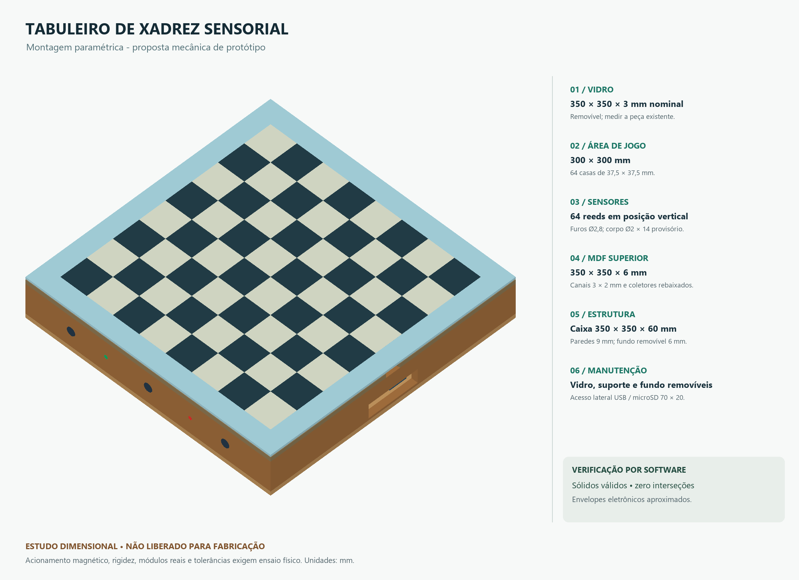

# Tabuleiro de Xadrez Sensorial

Projeto da disciplina **Certificadora da Competência 2**, do curso de **Engenharia de Computação da UTFPR — Câmpus Cornélio Procópio**.

## Objetivo

Desenvolver um tabuleiro de xadrez 8×8 capaz de detectar movimentações físicas, validar jogadas e registrar automaticamente partidas em formato **PGN**, permitindo sua reprodução e análise posterior pelos participantes do Clube de Xadrez Estudantil.

## Funcionamento

As peças possuem ímãs na base, e cada casa do tabuleiro conta com um **Reed Switch** para detectar sua ocupação. O **ESP32**, por meio do expansor **MCP23017**, acompanha as alterações dos sensores até o jogador confirmar a jogada.

O firmware interpreta essas alterações em conjunto com o estado lógico da partida e utiliza uma biblioteca de xadrez para validar o movimento. Jogadas inválidas são sinalizadas; jogadas válidas atualizam a partida e são registradas em **PGN** no cartão microSD.

## Tecnologias e componentes

- **ESP32:** controle principal, com firmware em C/C++ (Arduino).
- **64 Reed Switches e 64 diodos 1N4148:** matriz de sensoriamento 8×8.
- **MCP23017 (I²C):** leitura da matriz.
- **Ímãs de ferrite:** instalados na base das peças.
- **MicroSD (SPI):** armazenamento das partidas.
- **Botões, LEDs e buzzer:** confirmação de jogadas, promoção, encerramento e sinalização.
- **OLED SSD1315 (opcional):** exibição de informações da partida.

A estrutura física utilizará uma base de **MDF** e um **tabuleiro de vidro removível de 3 mm**, com dimensões externas aproximadas de 35 × 35 cm.

## Equipe

| Integrante | Responsabilidade |
| --- | --- |
| Bruno Ferreira de Lima | Testes, documentação e registro da partida |
| Daniel Chien Chen Wang | Eletrônica e estrutura física |
| Gustavo Yudi Yamada | Algoritmos e biblioteca de xadrez |
| Pedro Paulo da Silva Oliveira | Firmware e interface com hardware |
| Tadashi Bello Nagashima | Coordenação e integração |

## Documentação técnica

- [Requisitos](docs/requisitos.md) e [arquitetura](docs/arquitetura.md).
- [Eletrônica](docs/eletronica.md): componentes, pinagem e esquemático KiCad.
- [Mecânica](docs/mecanica.md): dimensões, modelo FreeCAD e exportações.
- [Diagnóstico Arduino](docs/firmware-diagnostico.md): configuração, compilação e operação.
- [Acompanhamento da jogada](docs/firmware-acompanhamento.md): módulo C++ independente, contrato e testes automatizados.
- [Avaliação de bibliotecas de xadrez](docs/avaliacao-bibliotecas-xadrez.md): comparação isolada, testes reproduzíveis e recomendação para ESP32.
- [Adaptador THC](docs/firmware-xadrez.md): posição lógica, movimentos legais, SAN e consultas de encerramento.
- [Interpretação da movimentação](docs/firmware-interpretacao.md): correspondência entre observações físicas e movimentos legais, contrato e testes.
- [Controle da partida](docs/firmware-controle.md): confirmação, promoção, atualização oficial e encerramento, independente do hardware.
- [Registro SAN/PGN](docs/firmware-registro.md): sequência de lances aceitos, metadados, resultado e exportação da partida em memória.
- [Decisões elétricas](docs/revisao-componentes-adicionais.md): leitura direta, alimentação e alternativas condicionadas aos testes.
- [Plano de testes físicos](docs/plano-testes-fisicos.md): resultados preliminares e critérios de validação.



## Estado e validação

O esquemático da revisão B usa a DevKit V1 de 30 pinos, alimentada pelo USB do computador. A matriz é lida diretamente pelo MCP23017 com pull-ups de 47 kΩ; os periféricos usam o regulador da própria DevKit. O CAD permanece como proposta de montagem, sujeita às medidas e aos testes físicos.

O firmware de diagnóstico inspeciona matriz, botões, indicadores e leitura/escrita do SD. O acompanhamento da jogada preserva as alterações de ocupação por quadro, o adaptador THC fornece posição lógica e regras de xadrez, e a interpretação relaciona as observações aos movimentos legais. O Controle coordena esses módulos e aplica somente lances confirmados e validados, com seleção explícita de promoção. O Registro gera SAN dos lances aceitos e exporta PGN em memória. Os cinco módulos possuem testes automatizados. A integração com a aquisição física, a interface da partida e a persistência das partidas em SD permanecem pendentes.

Cada guia contém os comandos de reprodução e os relatórios da respectiva área. Após atualizar as exportações e a compilação, executar da raiz:

```powershell
python .\scripts\validar_integracao.py
```

A [verificação integrada](validacao/integracao.json) confere a consistência entre netlist, BOM, firmware e coordenadas do CAD; não recompila nem regenera os arquivos. As verificações por software e os ensaios magnéticos preliminares não substituem a validação elétrica e mecânica do conjunto montado.
