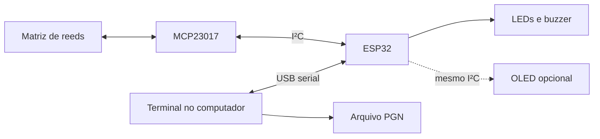

# Arquitetura e requisitos

O produto acompanha a ocupação de um tabuleiro 8×8, interpreta as transições quando o jogador confirma e registra lances legais em PGN. Reeds detectam presença; não identificam peças. A posição lógica e o histórico de transições são informações distintas.

## Organização

A montagem adota USB do computador, regulador da DevKit V1, matriz direta e oito pull-ups de 47 kΩ. Conexões e parâmetros estão em [hardware.md](hardware.md).

| Componente | Responsabilidade |
| --- | --- |
| `Hardware` / aquisição | Varrer o MCP23017, publicar quadros completos e informar falhas. |
| `MoveTracker` | Preservar alterações de ocupação e confiabilidade da tentativa. |
| `ChessAdapter` | Manter posição, regras legais e SAN, usando THC local. |
| `MoveInterpreter` | Relacionar snapshot da tentativa e posição oficial sem modificar nenhum deles. |
| `GameController` | Coordenar observação, confirmação, promoção, retomada e encerramento. |
| `GameRecord` | Registrar lances aceitos e produzir PGN consistente com os contextos recebidos. |
| `BoardApp` | Filtrar sensores, atualizar sinais e coordenar Controle/Registro. |
| `terminal.py` | Operar a partida, conferir o PGN recebido e publicá-lo no computador. |
| `Display` | Exibir o estado da aplicação no OLED opcional pelo mesmo Wire da matriz. |
| `SerialGame` | Console e comandos do simulador; não recebe entradas simuladas na aplicação física. |
| `main.cpp` / simulador | Adaptar GPIO e Serial ou ocupações simuladas e stdin/stdout à mesma aplicação. |

O fluxo é `MCP23017 → Hardware → BoardApp → GameController → MoveTracker/MoveInterpreter/ChessAdapter`. O terminal envia comandos a `SerialGame`, que aciona a mesma aplicação nos dois ambientes. O simulador fornece ocupações com relógio virtual.

As chamadas no ESP32 são serializadas no `loopTask`. Uma lacuna de aquisição invalida a tentativa. Ao confirmar, o Controle e o Registro só publicam a nova posição e o PGN depois que ambos aceitam o lance. O OLED consulta o estado publicado e atualiza pequenos trechos de texto. O primeiro erro de transferência desativa sua saída.

No encerramento, o ESP32 anuncia o identificador da partida, o tamanho e o CRC do PGN. O terminal solicita o registro, verifica a integridade, grava um arquivo novo e confirma o identificador. Até receber a confirmação, a placa mantém o PGN disponível em RAM e recusa outra partida. A consulta inicial do terminal recupera uma gravação pendente se a placa continuar ligada.

A tentativa começa com uma observação igual à ocupação oficial. Após rejeição ou interrupção, a reposição e uma nova observação compatível permitem retomar. Igualdade de ocupação não verifica identidade das peças. Capturas exigem observar a vacância do destino; transições perdidas entre amostras não são reconstruídas. As peças devem ser levantadas, evitando arraste.

O [guia de firmware](firmware.md) define os contratos e a operação. O [projeto Astah](diagramas/tabuleiro-xadrez-sensorial.asta) preserva os diagramas editáveis da concepção original; o fluxo acima descreve o protótipo USB atual. As exportações são feitas pelo próprio editor.

## Estado do projeto

A aplicação física, os cinco módulos e o simulador estão implementados. A integração foi verificada por software, incluindo leitura simulada, controle serial, sinais e persistência em arquivos. O funcionamento na montagem completa ainda não foi validado: os tempos de aquisição e os componentes reais exigem bancada. O diagnóstico de periféricos permanece separado para essa etapa. Verificações por software não validam magnetismo, alimentação ou montagem.

## Requisitos funcionais

| ID | Requisito | Critério de aceitação |
| --- | --- | --- |
| RF01 | O sistema deve identificar a ocupação de cada uma das 64 casas do tabuleiro. | Para cada casa, o estado informado corresponde à presença ou ausência de uma peça. |
| RF02 | O sistema deve acompanhar as alterações de ocupação durante a execução física de uma jogada, incluindo estados intermediários. | As transições detectadas permanecem disponíveis para a interpretação da jogada até sua confirmação. |
| RF03 | O sistema deve permitir a confirmação do término da movimentação física pelo terminal USB. | O comando `confirm` inicia a interpretação da jogada realizada. |
| RF04 | O sistema deve identificar o movimento candidato com base no estado lógico da partida, na ocupação física e nas alterações observadas. | O movimento candidato corresponde ao lance fisicamente executado, incluindo as informações adicionais necessárias. |
| RF05 | O sistema deve validar os movimentos candidatos de acordo com as regras do xadrez, incluindo capturas, roque, *en passant* e promoção. | Movimentos legais são aceitos e movimentos ilegais são rejeitados, inclusive nas situações especiais. |
| RF06 | O sistema deve atualizar o estado lógico da partida somente após a confirmação e a validação do lance. | A posição lógica é atualizada após um lance confirmado e válido e permanece inalterada nos demais casos. |
| RF07 | O sistema deve sinalizar visual e sonoramente a rejeição de uma jogada. | Uma jogada rejeitada produz ambas as sinalizações de erro. |
| RF08 | O sistema deve permitir a seleção da peça de promoção entre dama, torre, bispo e cavalo. | O terminal aceita Q/R/B/N e uma nova confirmação aplica a peça escolhida. |
| RF09 | O sistema deve permitir o encerramento manual da partida, inclusive por abandono. | A partida pode ser encerrada sem a realização de outro lance, e o encerramento é refletido em seu registro. |
| RF10 | O sistema deve reconhecer condições de encerramento da partida por meio da biblioteca de xadrez integrada. | As condições de encerramento suportadas pela biblioteca são identificadas quando ocorrem. |
| RF11 | O sistema deve registrar os lances válidos em notação algébrica padrão (SAN) e gerar o arquivo da partida em formato PGN. | O arquivo PGN contém, na ordem correta, os lances aceitos com a notação correspondente. |
| RF12 | O sistema deve salvar automaticamente o PGN no computador. | Um encerramento publica um novo arquivo e uma falha permite nova tentativa sem perder o registro. |
| RF13 | O OLED opcional deve informar vez, último lance, rejeição, xeque e encerramento. | Ausência ou erro de comunicação do display permite continuar a partida pelo terminal enquanto o barramento da matriz estiver operacional. |

## Requisitos não funcionais

| ID | Requisito | Critério de aceitação |
| --- | --- | --- |
| RNF01 | O sensoriamento deve distinguir de forma confiável a ocupação das casas, sem acionamentos indevidos de casas adjacentes. | Nas condições de operação verificadas, a presença de uma peça é detectada na casa correspondente sem gerar leituras falsas nas casas vizinhas. |
| RNF02 | O firmware deve separar as responsabilidades de sensoriamento, acompanhamento e interpretação de jogadas, regras de xadrez, interface e registro da partida. | O código apresenta módulos ou componentes identificáveis para essas responsabilidades, permitindo sua verificação separada. |
| RNF03 | Os circuitos e módulos conectados ao ESP32 devem utilizar alimentação e níveis elétricos compatíveis. | As tensões de alimentação e de sinal respeitam as especificações dos componentes conectados. |
