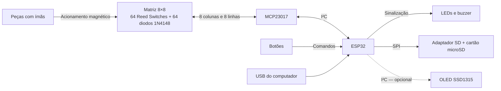
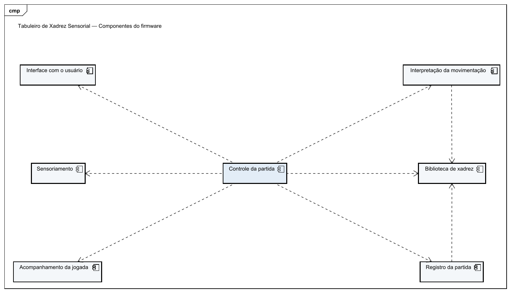
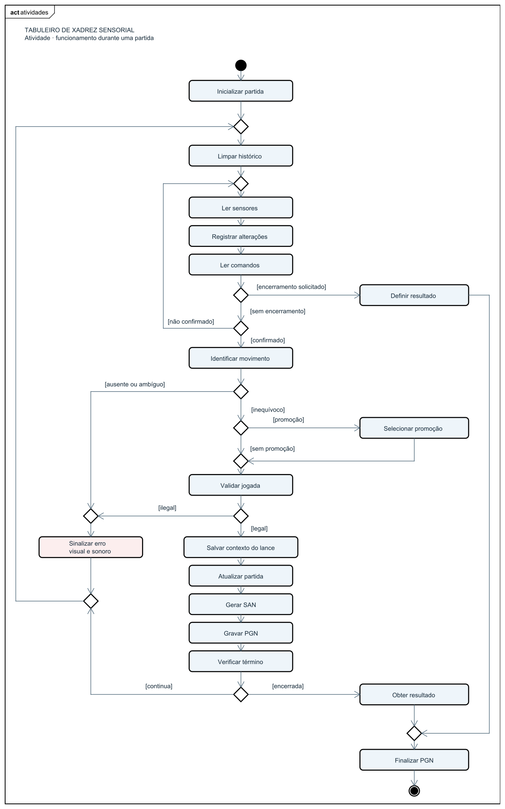

# Arquitetura do Sistema

## 1. Arquitetura eletrônica

O MCP23017 seleciona uma coluna LOW por vez, mantendo as demais em alta impedância, e lê diretamente as linhas com pull-ups de 47 kΩ. A DevKit V1 de 30 pinos fornece 3,3 V aos periféricos pelo regulador da própria placa. O OLED é opcional e compartilha o I²C quando instalado. A [documentação elétrica](eletronica.md) define a pinagem e as conexões adotadas; [board_config.h](../firmware/diagnostico/board_config.h) mantém a referência no firmware.

## 2. Organização do firmware

O firmware será desenvolvido em C/C++ no ecossistema Arduino. Seus módulos e as relações entre eles são representados no diagrama de componentes:

Os diagramas também estão disponíveis no
[projeto Astah editável](diagramas/tabuleiro-xadrez-sensorial.asta).

O [acompanhamento da jogada](firmware-acompanhamento.md) está implementado como módulo C++ independente. Recebe observações do Controle e fornece uma cópia da tentativa, mantendo as dependências representadas no diagrama. O guia do módulo define o contrato, os limites do histórico e as verificações automatizadas; sua integração com o sensoriamento permanece pendente.

O [adaptador THC](firmware-xadrez.md) implementa a responsabilidade da biblioteca de xadrez: posição lógica, consulta de movimentos legais, aplicação validada, SAN e condições de encerramento. Também é C++ independente, sem ligação com o acompanhamento ou periféricos.

A [interpretação da movimentação](firmware-interpretacao.md) recebe do Controle uma cópia da tentativa e consulta o adaptador para identificar um movimento legal compatível. A dependência do tipo `AttemptSnapshot` não implica consultar diretamente o acompanhamento ativo. A interpretação preserva a posição oficial e informa ausência de correspondência, ambiguidade, promoção pendente ou entrada não confiável.

O [Controle da partida](firmware-controle.md) mantém adaptador e acompanhamento, recebe comandos lógicos de observação, confirmação, promoção e encerramento e coordena a aplicação oficial. É C++ independente de Arduino; uma tentativa começa somente após uma leitura compatível com a ocupação oficial. Seu guia define as transições, a retomada após rejeição e a política de encerramento. Sensoriamento, interface e registro continuam etapas de integração próprias; os diagramas representam a organização completa prevista.

## 3. Estados e processamento das jogadas

A interpretação das jogadas utiliza três informações:

- **Posição lógica:** estado oficial da partida, mantido pela biblioteca de xadrez.
- **Ocupação física:** indicação instantânea de casa ocupada ou vazia.
- **Alterações da jogada:** sequência de transições detectadas até a confirmação.

Os Reed Switches não identificam as peças. Em uma captura, por exemplo, a casa de destino pode apresentar a sequência **ocupada → vazia → ocupada**, tornando necessário considerar as alterações intermediárias.

