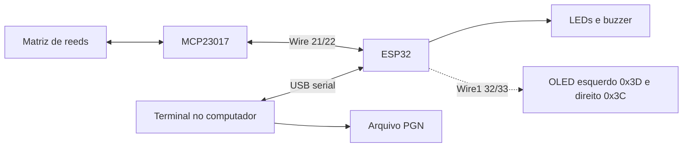

# Arquitetura e requisitos

O produto acompanha a ocupação de um tabuleiro 8×8, combina a posição legal com a ocupação observada quando o jogador confirma com Enter e registra lances legais em PGN. Reeds detectam presença; não identificam peças. A posição lógica e o histórico de transições são informações distintas.

## Organização

A montagem adota USB do computador, regulador da DevKit V1, matriz direta e oito pull-ups de 47 kΩ. Conexões e parâmetros estão em [hardware.md](hardware.md).

| Componente | Responsabilidade |
| --- | --- |
| `Hardware` / aquisição | Varrer o MCP23017, publicar quadros completos e informar falhas. |
| `MoveTracker` | Preservar alterações de ocupação e confiabilidade da tentativa. |
| `ChessAdapter` | Manter posição, regras legais e SAN, usando THC local. |
| `MoveInterpreter` | Relacionar snapshot da tentativa e posição oficial sem modificar nenhum deles. |
| `GameController` | Coordenar observação, confirmação, promoção, retomada e encerramento. |
| `GameRecord` | Registrar lances aceitos e produzir PGN consistente com os contextos recebidos. |
| `BoardApp` | Filtrar sensores, atualizar sinais e coordenar Controle/Registro. |
| `terminal.py` | Operar a partida, conferir o PGN recebido e publicá-lo no computador. |
| `Display` | Exibir a prévia física, o lance confirmado e a animação da partida nos dois OLEDs opcionais pelo barramento dedicado Wire1. |
| `SerialGame` | Console e comandos do simulador; não recebe entradas simuladas na aplicação física. |
| `main.cpp` / simulador | Adaptar GPIO e Serial ou ocupações simuladas e stdin/stdout à mesma aplicação. |

O firmware da partida e o diagnóstico usam o mesmo [driver da matriz](../firmware/BoardHardware.h). O simulador substitui os contatos por leituras com relógio virtual e usa o mesmo filtro e o mesmo protocolo da placa.

A cada Enter, o interpretador compara a ocupação final com a de todos os lances legais gerados pela THC. Num roque são quatro casas alteradas. Numa captura comum, o destino já estava ocupado, por isso a saída e o pouso ajudam a identificar a vítima. Se o jogador precisar esclarecer o destino, o controle conserva a posição e pede um gesto local. Uma posição ilegal ou uma perda real de aquisição exige reposição.

Dois jogadores, máquina e tutoriais usam o mesmo caminho de confirmação. A máquina escolhe uma resposta entre os lances ordenados da THC. Os tutoriais fornecem uma FEN e uma sequência de movimentos físicos. A sugestão é conferida após a identificação do gesto. O controle aplica o lance numa cópia da posição e o registro confere o SAN, a posição resultante e o resultado antes de publicar a jogada.

O computador confirma a gravação somente depois de verificar e publicar o PGN. Enquanto aguarda essa confirmação, o ESP32 conserva a partida encerrada em RAM. O [guia de firmware](firmware.md) descreve a recuperação e os comandos. O [modelo Astah](diagramas/tabuleiro-xadrez-sensorial.asta) preserva os diagramas editáveis da concepção original.

## Requisitos funcionais

| ID | Comportamento verificável |
| --- | --- |
| RF01 | Cada reed indica a ocupação de sua casa. |
| RF02 | A aquisição preserva transições estáveis e vacâncias breves relevantes para distinguir capturas. |
| RF03 | Enter no terminal solicita a interpretação da tentativa. A espera ou o pouso isolado preservam a vez. |
| Modo máquina | A aplicação guarda a sugestão legal das pretas. O terminal e o OLED mostram a origem e o destino, e o controle verifica a execução física antes de registrar a resposta. |
| Tutorial | Selecionar e reiniciar roque, promoção ou en passant. O terminal orienta a montagem e cada ação física. O último passo encerra o registro da lição. |
| RF04 | A confirmação exige um candidato identificável na posição oficial. Um destino de captura indistinguível pode ser esclarecido levantando e recolocando a peça. |
| RF05 | A validação cobre capturas, roque, en passant e promoção. |
| RF06 | Apenas lances confirmados e legais atualizam a posição. |
| RF07 | LED vermelho e buzzer sinalizam rejeição. |
| RF08 | O jogador escolhe Q/R/B/N pelo terminal para concluir a promoção. |
| RF09 | O terminal permite encerrar a partida ou registrar abandono. |
| RF10 | Mate, afogamento e material insuficiente reconhecido pela THC encerram a partida. |
| RF11 | O PGN contém os lances aceitos em SAN e o resultado correspondente. |
| RF12 | O terminal salva o PGN automaticamente em arquivo novo e permite repetir uma gravação pendente. |
| RF13 | Os dois OLEDs coordenam vez, lances, tutoriais, reposição e encerramento. A aquisição e o PGN funcionam com um painel ausente. |

## Requisitos não funcionais

| ID | Critério |
| --- | --- |
| RNF01 | Uma peça aciona apenas a casa correspondente nas condições de montagem ensaiadas. |
| RNF02 | Aquisição, interpretação, regras, controle, interface e registro têm responsabilidades identificáveis e podem ser verificados separadamente. |
| RNF03 | Alimentação e sinais respeitam os limites dos componentes. A validação elétrica exige medição na montagem. |
