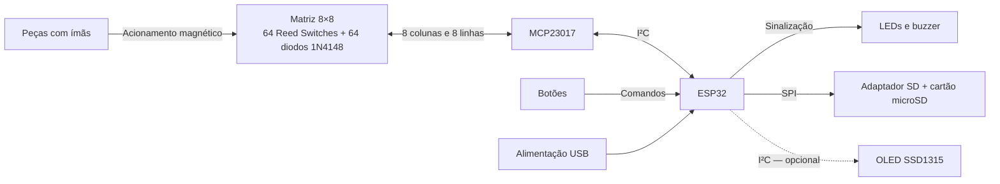

# Arquitetura do Sistema

## 1. Arquitetura eletrônica

O MCP23017 seleciona sequencialmente as colunas e lê as linhas da matriz. O OLED, caso utilizado, compartilhará o barramento I²C. A pinagem definitiva será estabelecida durante a implementação.

## 2. Organização do firmware

O firmware será desenvolvido em C/C++ no ecossistema Arduino. Seus módulos e as relações entre eles são representados no diagrama de componentes:

Os diagramas também estão disponíveis no
[projeto Astah editável](diagramas/tabuleiro-xadrez-sensorial.asta).

## 3. Estados e processamento das jogadas

A interpretação das jogadas utiliza três informações:

- **Posição lógica:** estado oficial da partida, mantido pela biblioteca de xadrez.
- **Ocupação física:** indicação instantânea de casa ocupada ou vazia.
- **Alterações da jogada:** sequência de transições detectadas até a confirmação.

Os Reed Switches não identificam as peças. Em uma captura, por exemplo, a casa de destino pode apresentar a sequência **ocupada → vazia → ocupada**, tornando necessário considerar as alterações intermediárias.

