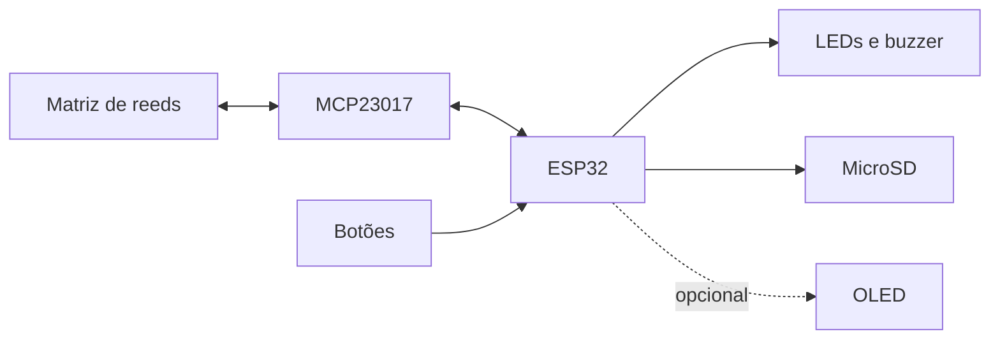

# Arquitetura e requisitos

O produto acompanha a ocupação de um tabuleiro 8×8, interpreta as transições quando o jogador confirma e registra lances legais em PGN. Reeds detectam presença; não identificam peças. A posição lógica e o histórico de transições são informações distintas.

## Organização

A montagem adota USB do computador, regulador da DevKit V1, matriz direta e oito pull-ups de 47 kΩ. Conexões e parâmetros estão em [hardware.md](hardware.md).

| Componente | Responsabilidade |
| --- | --- |
| Aquisição | Produzir quadros completos e informar perda de continuidade; ainda não integrada à partida. |
| `MoveTracker` | Preservar alterações de ocupação e confiabilidade da tentativa. |
| `ChessAdapter` | Manter posição, regras legais e SAN, usando THC local. |
| `MoveInterpreter` | Relacionar snapshot da tentativa e posição oficial sem modificar nenhum deles. |
| `GameController` | Coordenar observação, confirmação, promoção, retomada e encerramento. |
| `GameRecord` | Registrar lances aceitos e produzir PGN consistente com os contextos recebidos. |
| `SerialGame` / `main.cpp` | Integrar Controle/Registro e substituir entradas físicas por comandos Serial. |

O fluxo implementado é `Serial → SerialGame → GameController → MoveTracker/MoveInterpreter/ChessAdapter`; `SerialGame` entrega os contextos ao Registro. As chamadas são serializadas no `loopTask`, fora de interrupções. Ao confirmar, cópias do Controle e do Registro são publicadas somente após ambas aceitarem; uma falha preserva posição e PGN anteriores e bloqueia a sessão até reiniciar.

A tentativa começa com uma observação igual à ocupação oficial. Após rejeição ou interrupção, a reposição e uma nova observação compatível permitem retomar. Igualdade de ocupação não verifica identidade das peças. Capturas exigem observar a vacância do destino; transições perdidas entre amostras não são reconstruídas. As peças devem ser levantadas, evitando arraste.

O [guia de firmware](firmware.md) define os contratos e a operação. O [projeto Astah](diagramas/tabuleiro-xadrez-sensorial.asta) preserva os diagramas editáveis da organização completa prevista; as exportações são feitas pelo próprio editor.

## Estado do projeto

A partida via Serial e os cinco módulos estão implementados. A montagem elétrica/mecânica é um projeto de protótipo: ainda faltam aquisição integrada, botões, sinalização física e gravação PGN em SD. O diagnóstico de periféricos é um programa separado. Verificações por software não validam magnetismo, alimentação ou montagem.

## Requisitos funcionais

| ID | Requisito | Critério de aceitação |
| --- | --- | --- |
| RF01 | O sistema deve identificar a ocupação de cada uma das 64 casas do tabuleiro. | Para cada casa, o estado informado corresponde à presença ou ausência de uma peça. |
| RF02 | O sistema deve acompanhar as alterações de ocupação durante a execução física de uma jogada, incluindo estados intermediários. | As transições detectadas permanecem disponíveis para a interpretação da jogada até sua confirmação. |
| RF03 | O sistema deve permitir a confirmação do término da movimentação física por meio de um botão. | O acionamento do botão inicia a interpretação da jogada realizada. |
| RF04 | O sistema deve identificar o movimento candidato com base no estado lógico da partida, na ocupação física e nas alterações observadas. | O movimento candidato corresponde ao lance fisicamente executado, incluindo as informações adicionais necessárias. |
| RF05 | O sistema deve validar os movimentos candidatos de acordo com as regras do xadrez, incluindo capturas, roque, *en passant* e promoção. | Movimentos legais são aceitos e movimentos ilegais são rejeitados, inclusive nas situações especiais. |
| RF06 | O sistema deve atualizar o estado lógico da partida somente após a confirmação e a validação do lance. | A posição lógica é atualizada após um lance confirmado e válido e permanece inalterada nos demais casos. |
| RF07 | O sistema deve sinalizar visual e sonoramente a rejeição de uma jogada. | Uma jogada rejeitada produz ambas as sinalizações de erro. |
| RF08 | O sistema deve permitir a seleção da peça de promoção entre dama, torre, bispo e cavalo. | Um botão percorre ciclicamente as opções, a seleção é indicada visualmente e a peça escolhida é aplicada à promoção. |
| RF09 | O sistema deve permitir o encerramento manual da partida, inclusive por abandono. | A partida pode ser encerrada sem a realização de outro lance, e o encerramento é refletido em seu registro. |
| RF10 | O sistema deve reconhecer condições de encerramento da partida por meio da biblioteca de xadrez integrada. | As condições de encerramento suportadas pela biblioteca são identificadas quando ocorrem. |
| RF11 | O sistema deve registrar os lances válidos em notação algébrica padrão (SAN) e gerar o arquivo da partida em formato PGN. | O arquivo PGN contém, na ordem correta, os lances aceitos com a notação correspondente. |
| RF12 | O sistema deve armazenar o arquivo PGN em cartão microSD removível. | O arquivo pode ser recuperado do cartão e lido externamente. |

## Requisitos não funcionais

| ID | Requisito | Critério de aceitação |
| --- | --- | --- |
| RNF01 | O sensoriamento deve distinguir de forma confiável a ocupação das casas, sem acionamentos indevidos de casas adjacentes. | Nas condições de operação verificadas, a presença de uma peça é detectada na casa correspondente sem gerar leituras falsas nas casas vizinhas. |
| RNF02 | O firmware deve separar as responsabilidades de sensoriamento, acompanhamento e interpretação de jogadas, regras de xadrez, interface e registro da partida. | O código apresenta módulos ou componentes identificáveis para essas responsabilidades, permitindo sua verificação separada. |
| RNF03 | Os circuitos e módulos conectados ao ESP32 devem utilizar alimentação e níveis elétricos compatíveis. | As tensões de alimentação e de sinal respeitam as especificações dos componentes conectados. |
