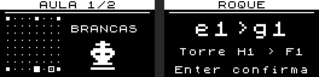

# Firmware

O [firmware da placa](../firmware/principal/src/main.cpp) e o [simulador](../firmware/simulador/main.cpp) compartilham `SerialGame`, `BoardApp`, o filtro de sensores e os cinco módulos C++14. O [terminal Python](../firmware/terminal.py) usa o mesmo protocolo para controlar os dois e gravar PGNs no computador.

## Compilar o simulador

Siga os [comandos de compilação e demonstração](../README.md#demonstração-sem-placa). O executável C++14 também aceita o protocolo bruto em stdin/stdout. Use o terminal Python para gravar os PGNs.

## Compilar e gravar o ESP32

Alvo: ESP32 clássico/ESP-WROOM-32, DevKit V1 de 30 pinos; CPU 240 MHz, flash 4 MiB QIO/80 MHz, partições `default.csv`, sem PSRAM. PlatformIO Core **6.2.0**, pioarduino **55.03.312**, Arduino-ESP32 **3.3.12** / IDF **5.5.5**. O cabeçalho DIO do bootloader QIO é esperado. O [platformio.ini](../firmware/principal/platformio.ini) usa as cinco bibliotecas locais por `symlink://` e baixa U8g2 2.36.18 para o OLED SSD1315.

Na raiz, com Python 3.13; preparar o ambiente uma vez:

```powershell
python -m venv --without-scm-ignore-files firmware/principal/build/venv
$python = '.\firmware\principal\build\venv\Scripts\python.exe'
$env:PLATFORMIO_CORE_DIR = Join-Path (Get-Location) 'firmware/principal/build/platformio-core'
$env:PYTHONIOENCODING = 'utf-8'
& $python -m pip install 'platformio==6.2.0'
& $python -m platformio run --project-dir firmware/principal --environment esp32
& $python -m serial.tools.list_ports -v
```

Em sessões seguintes, redefinir as variáveis sem recriar o ambiente. A primeira compilação baixa o toolchain/core. Substituir COM7 pela porta encontrada; upload substitui o programa da placa:

```powershell
& $python -m platformio run --project-dir firmware/principal --environment esp32 --target upload --upload-port COM7
& $python firmware/terminal.py --port COM7
```

Feche outros monitores que ocupem a porta. O ambiente PlatformIO já contém pySerial. Para rodar o terminal em outro ambiente Python, instale `python -m pip install pyserial==3.5`. A aplicação física preserva a pilha de 32 KiB do `loopTask` e o watchdog.

## Operar pelo terminal

Na abertura, Enter escolhe dois jogadores, 4 escolhe máquina e 2 abre a lista de tutoriais. No modo local, informe os nomes das brancas e pretas ou pressione Enter para usar as cores. Os nomes seguem para o PGN e o letreiro. A fonte do OLED aceita até 24 caracteres ASCII. O terminal simplifica acentos.

Monte a posição desenhada com A1 embaixo à esquerda. R, D, T, B, C e P representam rei, dama, torre, bispo, cavalo e peão. Maiúsculas são brancas. A placa reconhece a ocupação inicial e acende o verde. A cor e a identidade das peças devem ser conferidas por quem as monta.

**Mova as peças e confirme com Enter.** No roque, termine o movimento do rei e da torre. No en passant, retire também o peão ultrapassado. Na promoção, substitua o peão pela peça desejada, pressione Enter, escolha `promote Q`, `promote R`, `promote B` ou `promote N` e confirme novamente.

| Mensagem | Ação na mesa |
| --- | --- |
| **Complete o movimento** | Termine o gesto que começou e pressione Enter. |
| **A leitura ainda oscila** | Centralize as peças, aguarde a estabilização e confirme novamente. |
| **Confira a captura** | Erga a peça que capturou, deixe a casa livre por um instante e recoloque-a no mesmo destino. Pressione Enter. O terminal marca as casas possíveis. |
| **Reponha a posição** | Refaça a última posição aceita, inclusive a peça capturada. O terminal mostra as divergências. Aguarde o verde antes de tentar outro lance. |

| Comando no terminal | Efeito |
| --- | --- |
| Enter / `confirm` | Solicita a validação do lance montado. |
| 1 / `status`, 3 / `pgn` | Consulta posição e sensores ou exibe o PGN. `tecnico` inclui FEN, leituras e diagnóstico dos OLEDs. |
| 4 / `maquina`, 5 / `local` | Escolhe máquina de pretas ou dois jogadores. A troca entre essas duas modalidades preserva a posição. Ao sair de uma lição, abre uma partida inicial. |
| 6 / `nomes` | Edita os nomes dos jogadores. |
| 2 / `tutorial` | Lista as lições. Também aceita `tutorial roque`, `tutorial promocao` e `tutorial en-passant`. |
| `repetir` | Remonta a lição atual do primeiro passo. No protocolo, `tutorial restart`. |
| `new` | Inicia outra partida e descarta a posição ativa. |
| `finish` / `resign white` / `resign black` | Encerra com `*` ou registra abandono e oferece o PGN ao computador. |
| `pasta CAMINHO` / `save` | Corrige o destino local e repete a gravação pendente. O arquivo pendente deve ser salvo antes de trocar de sessão. |
| `oled 100` / `oled 400` | Na placa, seleciona a frequência de Wire1 em kHz e reinicializa os OLEDs. O boot começa em 100 kHz. |
| `metrics` | Na placa, consulta heap e folga de pilha em bytes. |
| `?` / `sair` | Mostra a ajuda ou fecha a conexão. |

A máquina escolhe um lance com `ChessEvaluation::GenLegalMoveListSorted` da THC. Execute a origem entre colchetes e o destino entre parênteses, incluindo a retirada da peça adversária se houver captura. Se a sugestão incluir promoção, use a peça anunciada. Enter confirma a resposta física. A lição de promoção pede também a escolha explícita da peça.

### Roteiro de apresentação

As duas primeiras cenas usam a mesma partida. Cada tutorial começa com sua própria montagem. No simulador, `sync` monta a posição pedida. Para mover, use `lift CASA` e `place CASA`. Enter em uma linha vazia ou `confirm` conclui cada lance. Na placa, faça as mesmas ações com as peças. O desenho do terminal mostra a posição oficial mesmo durante a reposição.

| Cena e montagem | Ações | O que mostrar |
| --- | --- | --- |
| Dois jogadores, posição inicial | Leve E2 a E5 e pressione Enter. Volte a E2, aguarde verde, mova E2 a E4, espere e só então pressione Enter. | A rejeição conserva a vez das brancas e o PGN vazio. O lance válido aparece como `1. e4 *`. |
| Máquina, mesma partida | Digite `maquina`. Execute a resposta preta destacada e confirme. Digite `finish`. | O tabuleiro muda de vez após a confirmação. Abra o PGN no caminho informado. |
| `tutorial roque`. Reis em E1/E8 e torres em A1/H1/A8/H8 | Mova E1–G1 **e** H1–F1, depois Enter. Mova E8–C8 **e** A8–D8, depois Enter. | Rei e torre compartilham um lance. O lado do roque muda e o PGN contém `1. O-O O-O-O *`. |
| `tutorial promocao`. Brancas com rei E1 e peão A7, pretas com rei H8 | Substitua o peão A7 por uma torre branca em A8. Enter, `promote R`, Enter. | A torre recém-promovida dá xeque na oitava fileira. Confira `a8=R+`. |
| `tutorial en-passant`. Brancas com rei E1 e peão E5, pretas com rei A8 e peão D7 | Avance D7–D5 e confirme. Agora mova E5–D6, retire o peão de D5 e confirme. | A captura termina em uma casa antes vazia. O PGN contém `1... d5 2. exd6 *`. Use `repetir` para remontar. |

É possível trocar ou repetir uma lição em andamento. Ao completar o último passo, o terminal salva o PGN com o nome da lição, a FEN inicial e SetUp. Para abrir uma lição depois de jogar uma partida comum com lances registrados, encerre e salve a partida.

### Cenas dos OLEDs



As prévias foram extraídas dos dois buffers de 128×64 do renderizador do firmware, com a fonte U8g2 e posições do simulador. A amostragem é de 40 ms. A tela esquerda corresponde a 0x3D e a direita a 0x3C. A taxa efetiva no vidro depende do volume de pixels enviados e da frequência de Wire1.

| Durante o jogo | Na apresentação |
| --- | --- |
| [Partida e captura](preview/partida.gif) · [Xeque-mate](preview/mate.gif) | Letreiro dos jogadores, deslocamento entre as telas, impacto e resultado. |
| [Roque](preview/roque.gif) · [Promoção](preview/promocao.gif) · [En passant](preview/en-passant.gif) | O mapa indica origem e destino. A segunda tela orienta o gesto e exibe o lance registrado. |
| [Esclarecer uma captura](preview/captura.gif) · [Repor a posição](preview/reposicao.gif) | Compare o pedido de levantar a peça no destino com o mapa de casas a corrigir após um lance ilegal. |

No simulador, demonstre o esclarecimento com `new ambiguous`, `sync`, `lift a1` e Enter. O tabuleiro só sabe que a torre saiu de A1. Erga e recoloque em B1 com `lift b1` e `place b1`, depois confirme. O PGN registra `Rxb1`. Para demonstrar mate, parta de `new` e `sync` e execute F2–F3, E7–E5, G2–G4 e D8–H4, confirmando cada lance.

## Da leitura à confirmação

- **Aquisição.** Wire varre o MCP23017 a 100 kHz, uma coluna por vez, com 300 µs de acomodação. A aplicação agenda uma leitura completa a cada 25 ms. Cada casa tem debounce próprio de 25 ms. Enter aguarda a próxima varredura e dá ao filtro até 200 ms para assentar. Se o gesto continuar instável, a tentativa fica aberta.
- **Captura.** A origem pode sair antes ou depois da vítima. Entre os lances legais com a mesma ocupação final, a reposição estável do destino com a origem vazia distingue a casa capturada. Se o filtro perder uma vacância breve, uma varredura completa que tenha visto o destino livre também ajuda quando há um único destino legal. Com evidência insuficiente ou conflitante, o controle pede o gesto de conferência. Uma sugestão da máquina ou do tutorial nunca substitui a observação.
- **Continuidade.** Após um intervalo superior a 100 ms entre amostras, o filtro estabiliza novamente a mesa. A ocupação final ainda pode identificar o lance. Transições que cruzaram a lacuna não provam uma captura. Ao esgotar os 64 quadros de histórico, a confirmação também reavalia o ponto de chegada. Uma falha comunicada pelo MCP descarta o quadro, põe o expansor em reset e exige reencontrar a posição oficial. A aplicação tenta reinicializá-lo a cada segundo.
- **OLEDs.** Dois buffers do mesmo instante permanecem fixos até o fim do envio. O driver intercala blocos de até 32 bytes a 100 kHz ou 64 bytes a 400 kHz, envia diferenças e atualiza o cache após ACK. Cada transação tem timeout de 12 ms. Um painel que volta a responder é reinicializado e recebe as oito páginas antes de acender. A sondagem ocorre a cada três segundos. `tecnico` mostra frequência, endereço e estado. A meta do renderizador é 25 FPS.

## Registro e protocolo

O registro gera SAN na posição anterior e verifica a posição resultante antes de avançar a partida. A THC avalia legalidade, xeque, mate, afogamento e material insuficiente. A posição inicial de uma lição segue nas etiquetas `SetUp` e `FEN`. O limite do registro é de 8192 bytes de texto de lances.

Ao encerrar a partida, o terminal recebe `SAVE_PENDING ID BYTES CRC32`, solicita `pgn ID` e confere tamanho e CRC antes de publicar um novo arquivo em `build/partidas/`. Só então devolve `saved ID`. Se a gravação falhar, mantenha a placa alimentada e use `pasta CAMINHO` e `save`. Um reset descarta a partida ainda em RAM. Em Linux e macOS, use uma pasta em volume com suporte a links físicos.

O protocolo 3 usa USB a 115200 baud, 8N1, comandos ASCII terminados por LF ou CRLF e respostas encerradas por `DONE`. `hello` devolve `PROTOCOL 3`. O simulador usa o mesmo protocolo em stdin/stdout. `sync` monta a posição oficial, `lift CASA` e `place CASA` movimentam uma peça, `raw HEX16` prepara a próxima leitura e `wait MS` avança o relógio. `interrupt` simula perda de aquisição. `help` lista os cenários aceitos por `new`. A entrada física reserva a ocupação exclusivamente à matriz.

## Diagnóstico de montagem

Requer Arduino CLI e core `esp32:esp32@3.3.12`; usa Wire do core. Instalar o core uma vez e compilar na raiz:

```powershell
arduino-cli core install esp32:esp32@3.3.12 --additional-urls https://espressif.github.io/arduino-esp32/package_esp32_index.json
arduino-cli compile --fqbn esp32:esp32:esp32 --warnings all --build-path firmware/diagnostico/build firmware/diagnostico
arduino-cli upload --fqbn esp32:esp32:esp32 --port COM7 --build-path firmware/diagnostico/build firmware/diagnostico
arduino-cli monitor --port COM7 --config baudrate=115200
```

| Comando | Efeito |
| --- | --- |
| `m` | Última matriz válida (`X` ocupada, `.` vazia). |
| `r` | Reinicializa e verifica MCP23017. |
| `v` | Alterna COL_a LOW estática para medição; suspende varredura. |
| `o` | Consulta 0x3C e 0x3D e informa ACK ou ausência de resposta em cada endereço. |
| `t` / `?` | Testa LEDs/buzzer por aproximadamente 120 ms / ajuda. |

O diagnóstico usa o [mesmo driver MCP23017 da aplicação](../firmware/BoardHardware.h) e exibe leituras brutas. Em falha, o driver descarta o quadro e mantém o MCP em RESET. Use `r` para retomar. Para testar texto no OLED, grave a aplicação principal.

A sequência de medições e os critérios de aceitação estão no [guia de bancada](hardware.md#conferência-antes-de-fabricar-e-usar).
